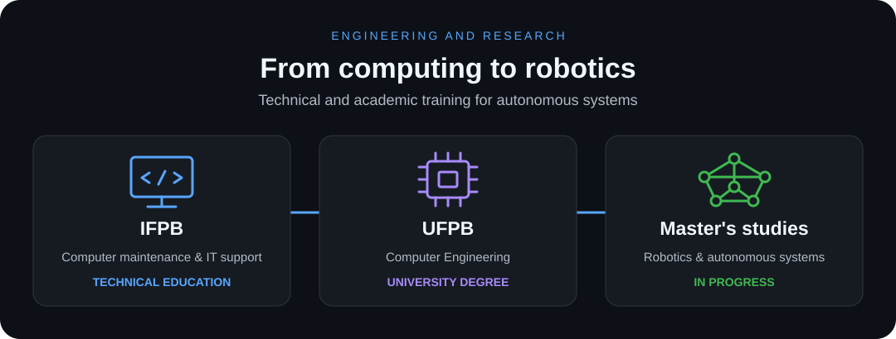

<a href="README.pt.md">Português</a> · <strong>English</strong>

<h1 align="center">Hi! I'm Wagner Garcia 👋</h1>

  <strong>Robotics · Localization · Computer vision</strong> 
  Research and software development for autonomous systems.

## About me

I'm **Wagner Garcia**, a robotics researcher at [LASER Robotics](https://github.com/LASER-Robotics), at the Federal University of Paraíba (UFPB). I focus on **localization, computer vision and robotic systems integration**.

My background includes work with **drones**, the subject of my undergraduate capstone project. With my team, I won the RoboCup Brasil Flying Robots category in 2023 and 2024.

## Education

- **Master's studies in progress** — research in robotics and autonomous systems.
- **Computer Engineering degree** — Federal University of Paraíba (UFPB).
- **Technical qualification in Computer Maintenance and IT Support** — Federal Institute of Paraíba (IFPB).

## Public projects

### [LUS — LASER UAV System](https://github.com/LASER-Robotics/laser_uav_system)

A ROS 2 framework for autonomous flight that I helped build at LASER. It integrates state estimation, planning and control, with Gazebo simulation and PX4 and ArduPilot interfaces.

### My contributions at LASER

Software development and integration contributions to LUS, organized by area:

<table>
  <tr>
    <td width="50%" valign="top">
      <h4>🧭 Estimation and sensors</h4>
      
State estimation, IMU filtering and shared C++ tools.

      

        <a href="https://github.com/LASER-Robotics/laser_uav_estimators" title="laser_uav_estimators">UAV Estimators</a> ·
        <a href="https://github.com/LASER-Robotics/laser_uav_imu_filter" title="laser_uav_imu_filter">IMU Filter</a> ·
        <a href="https://github.com/LASER-Robotics/laser_uav_lib" title="laser_uav_lib">UAV Library</a>
      

    </td>
    <td width="50%" valign="top">
      <h4>📷 Visual odometry</h4>
      
Localization with cameras and IMUs, including OpenVINS integration into LUS.

      

        <a href="https://github.com/LASER-Robotics/open_vins" title="open_vins — LASER fork">OpenVINS</a> ·
        <a href="https://github.com/LASER-Robotics/laser_open_vins_core" title="laser_open_vins_core">OpenVINS Core</a>
      

    </td>
  </tr>
  <tr>
    <td width="50%" valign="top">
      <h4>📡 LiDAR odometry</h4>
      
Localization and mapping with LiDAR and IMU data, with FAST-LIO integration into LUS.

      

        <a href="https://github.com/LASER-Robotics/FAST_LIO" title="FAST_LIO — LASER fork">FAST-LIO</a> ·
        <a href="https://github.com/LASER-Robotics/laser_fast_lio_core" title="laser_fast_lio_core">FAST-LIO Core</a>
      

    </td>
    <td width="50%" valign="top">
      <h4>⚙️ Integration and simulation</h4>
      
System management, models, environments and Gazebo plugins.

      

        <a href="https://github.com/LASER-Robotics/laser_uav_managers" title="laser_uav_managers">UAV Managers</a> ·
        <a href="https://github.com/LASER-Robotics/laser_uav_simulation" title="laser_uav_simulation">UAV Simulation</a> 
        <a href="https://github.com/LASER-Robotics/laser_challenge_simulation" title="laser_challenge_simulation">Challenge Simulation</a> ·
        <a href="https://github.com/LASER-Robotics/laser_gazebo_resources" title="laser_gazebo_resources">Gazebo Resources</a>
      

    </td>
  </tr>
</table>

### Personal projects

| Repository | What I develop |
| :--- | :--- |
| [**uav_waypoint**](https://github.com/wagnerdgarcia/uav_waypoint) | A C++ ROS 2 package for loading and managing waypoints and sending trajectories to drones. |
| [**template_ros_2_package**](https://github.com/wagnerdgarcia/template_ros_2_package) | An educational C++ template for ROS 2 packages, covering nodes, topics, services, parameters and lifecycle management. |

[All my repositories ↗](https://github.com/wagnerdgarcia?tab=repositories) · [LASER projects ↗](https://github.com/orgs/LASER-Robotics/repositories)

## Technologies

  
  
  
  
  
  
  

  
  
  

## My GitHub in numbers

  

  
  

<strong>Code:</strong> size across my repositories. <strong>Commits:</strong> contributions to my own and other owners' repositories.

## Let's connect

  
  
  

