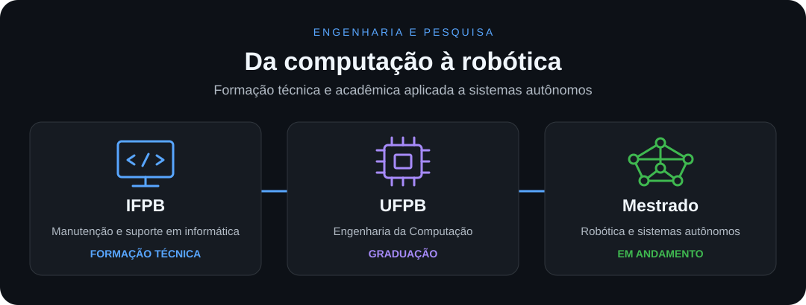

<strong>Português</strong> · <a href="README.md">English</a>

<h1 align="center">Olá! Sou Wagner Garcia 👋</h1>

  <strong>Robótica · Localização · Visão computacional</strong> 
  Pesquisa e desenvolvimento de software para sistemas autônomos.

## Sobre mim

Sou **Wagner Garcia**, pesquisador em robótica no [LASER Robotics](https://github.com/LASER-Robotics), da UFPB. Meu foco é **localização, visão computacional e integração de sistemas robóticos**.

Minha trajetória passa pelos **drones**, tema do meu TCC. Com a equipe, fui bicampeão da RoboCup Brasil na categoria Flying Robots, em 2023 e 2024.

## Formação

- **Mestrado em andamento** — pesquisa em robótica e sistemas autônomos.
- **Engenharia da Computação** — Universidade Federal da Paraíba (UFPB).
- **Técnico em Manutenção e Suporte em Informática** — Instituto Federal da Paraíba (IFPB).

## Projetos públicos

### [LUS — LASER UAV System](https://github.com/LASER-Robotics/laser_uav_system)

Framework ROS 2 de voo autônomo que ajudei a construir no LASER. Integra estimação de estado, planejamento e controle, com simulação no Gazebo e interfaces PX4 e ArduPilot.

### Minhas contribuições no LASER

Contribuições em desenvolvimento e integração de software para o LUS, organizadas por área:

<table>
  <tr>
    <td width="50%" valign="top">
      <h4>🧭 Estimação e sensores</h4>
      
Estimação de estado, filtragem de IMU e ferramentas compartilhadas em C++.

      

        <a href="https://github.com/LASER-Robotics/laser_uav_estimators" title="laser_uav_estimators">UAV Estimators</a> ·
        <a href="https://github.com/LASER-Robotics/laser_uav_imu_filter" title="laser_uav_imu_filter">IMU Filter</a> ·
        <a href="https://github.com/LASER-Robotics/laser_uav_lib" title="laser_uav_lib">UAV Library</a>
      

    </td>
    <td width="50%" valign="top">
      <h4>📷 Odometria visual</h4>
      
Localização com câmeras e IMU, incluindo a integração do OpenVINS ao LUS.

      

        <a href="https://github.com/LASER-Robotics/open_vins" title="open_vins — fork do LASER">OpenVINS</a> ·
        <a href="https://github.com/LASER-Robotics/laser_open_vins_core" title="laser_open_vins_core">OpenVINS Core</a>
      

    </td>
  </tr>
  <tr>
    <td width="50%" valign="top">
      <h4>📡 Odometria LiDAR</h4>
      
Localização e mapeamento com LiDAR e IMU, com integração do FAST-LIO ao LUS.

      

        <a href="https://github.com/LASER-Robotics/FAST_LIO" title="FAST_LIO — fork do LASER">FAST-LIO</a> ·
        <a href="https://github.com/LASER-Robotics/laser_fast_lio_core" title="laser_fast_lio_core">FAST-LIO Core</a>
      

    </td>
    <td width="50%" valign="top">
      <h4>⚙️ Integração e simulação</h4>
      
Gerenciamento do sistema, modelos, ambientes e plugins para o Gazebo.

      

        <a href="https://github.com/LASER-Robotics/laser_uav_managers" title="laser_uav_managers">UAV Managers</a> ·
        <a href="https://github.com/LASER-Robotics/laser_uav_simulation" title="laser_uav_simulation">UAV Simulation</a> 
        <a href="https://github.com/LASER-Robotics/laser_challenge_simulation" title="laser_challenge_simulation">Challenge Simulation</a> ·
        <a href="https://github.com/LASER-Robotics/laser_gazebo_resources" title="laser_gazebo_resources">Gazebo Resources</a>
      

    </td>
  </tr>
</table>

### Projetos pessoais

| Repositório | O que desenvolvo |
| :--- | :--- |
| [**uav_waypoint**](https://github.com/wagnerdgarcia/uav_waypoint) | Pacote ROS 2 em C++ para carregar e gerenciar waypoints e enviar trajetórias para drones. |
| [**template_ros_2_package**](https://github.com/wagnerdgarcia/template_ros_2_package) | Base didática em C++ para pacotes ROS 2, com nós, tópicos, serviços, parâmetros e ciclo de vida. |

[Todos os meus repositórios ↗](https://github.com/wagnerdgarcia?tab=repositories) · [Projetos do LASER ↗](https://github.com/orgs/LASER-Robotics/repositories)

## Tecnologias

  
  
  
  
  
  
  

  
  
  

## Meu GitHub em números

  

  
  

<strong>Código:</strong> volume nos meus repositórios. <strong>Commits:</strong> contribuições em repositórios próprios e de terceiros.

## Vamos conversar

  
  
  

